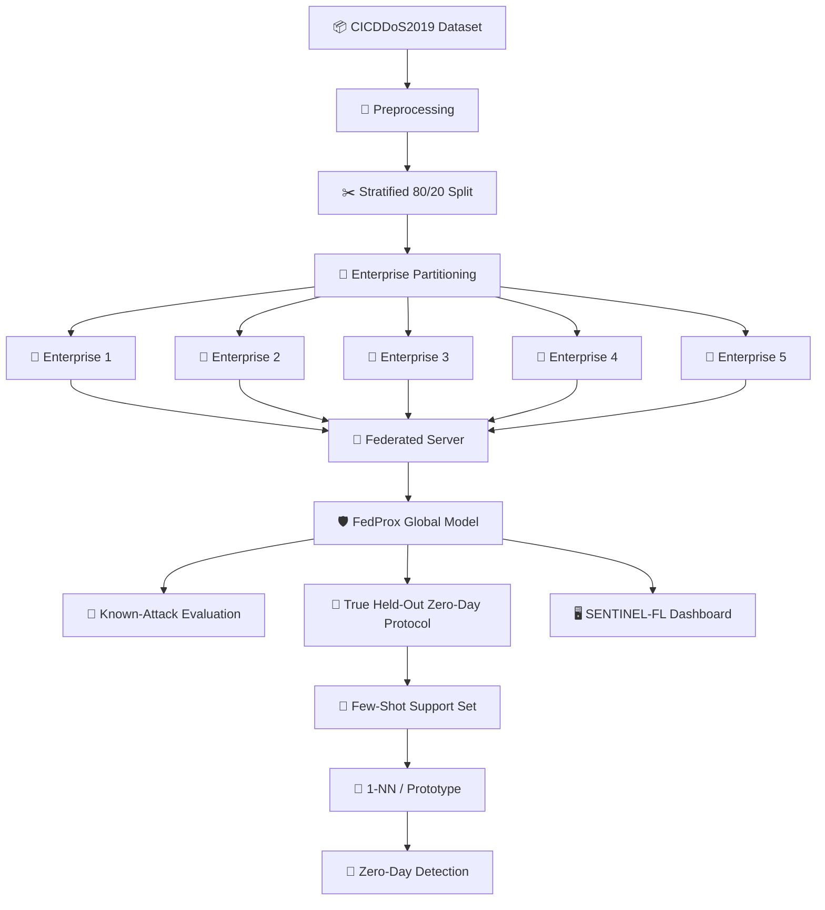

# 🛡️ SENTINEL-FL
### Federated Few-Shot Learning for Zero-Day DDoS Intrusion Detection Across Distributed Enterprise Networks

<p align="center">


</p>

<p align="center">


</p>

---

## 🚨 Overview

**SENTINEL-FL** is a research-oriented **Federated Learning + Few-Shot Learning framework** designed for detecting DDoS attacks across distributed enterprise networks without requiring raw enterprise traffic to be centralized.

The system combines:

> 🏢 **Distributed Enterprise Clients**  
> ↓  
> 🧠 **Federated Learning**  
> ↓  
> 🛡️ **FedProx Global Model**  
> ↓  
> 🔬 **Few-Shot Adaptation**  
> ↓  
> 🚨 **Zero-Day Attack Detection**  
> ↓  
> 📊 **Security Operations Dashboard**

The project evaluates whether a globally trained model can learn from **non-IID enterprise data** while allowing a previously unseen DDoS attack class to be detected using only a small number of labeled examples.

---

## ✨ Key Features

| Feature | Description |
|---|---|
| 🏢 **Federated Learning** | Five simulated enterprise clients collaboratively train a global model |
| 🔀 **Non-IID Data** | Enterprise clients contain deliberately different attack distributions |
| 🧠 **FedAvg Baseline** | Sample-weighted federated averaging |
| 🛡️ **FedProx** | Proximal regularization for heterogeneous client distributions |
| 🚨 **Zero-Day Evaluation** | Target attack classes are completely held out before federated training |
| 🎯 **Few-Shot Adaptation** | Detection using only 10 / 20 / 50 / 100 labeled support samples |
| 🔎 **1-NN Adaptation** | Cosine-similarity nearest-neighbor detection |
| 🧬 **Prototype Adaptation** | Class prototype based few-shot detection |
| 📊 **Research Benchmarks** | Centralized, FedAvg and FedProx comparisons |
| 🖥️ **SOC Dashboard** | Real-time-style security monitoring interface |
| 🚦 **Incident Management** | Threat severity, confidence and mitigation workflow |
| 🧪 **Held-Out Replay** | Dashboard inference uses an exact held-out test pool |
| 🔐 **Data Locality** | Raw enterprise samples remain local during FL simulation |

---

# 🧠 Research Problem

Traditional centralized intrusion detection systems require enterprise traffic to be collected at a central location.

This creates several challenges:

- 🔒 Sensitive network traffic may not be shareable.
- 🌐 Enterprise environments have different traffic distributions.
- 📉 A model trained on known attacks may struggle with unseen attacks.
- 🎯 Zero-day attacks have little or no labeled training data.
- 🏢 Different organizations may observe very different attack patterns.

### Research Question

> **Can federated learning provide a useful global DDoS detection model across heterogeneous enterprise networks, while few-shot adaptation enables detection of previously unseen attack classes?**

---

# 🏗️ System Architecture



---

# 🔬 Research Pipeline

```text
                    ┌─────────────────────┐
                    │   CICDDoS2019       │
                    │   90,439 samples    │
                    └──────────┬──────────┘
                               │
                               ▼
                    ┌─────────────────────┐
                    │   Preprocessing     │
                    │   81 features       │
                    └──────────┬──────────┘
                               │
                               ▼
                    ┌─────────────────────┐
                    │   80 / 20 Split     │
                    └──────────┬──────────┘
                               │
              ┌────────────────┴────────────────┐
              ▼                ▼                ▼
         Centralized       Enterprise       True Held-Out
          Baselines        Partitioning        Protocol
              │                │                │
              ▼                ▼                ▼
          Random Forest    E1 → E5         Target Removed
          Centralized NN       │                │
                               ▼                ▼
                           FedAvg           FedProx
                               │                │
                               └───────┬────────┘
                                       ▼
                              Global 12/13-Class Model
                                       │
                                       ▼
                              Few-Shot Adaptation
                                       │
                              ┌────────┴────────┐
                              ▼                 ▼
                            1-NN           Prototype
                              │                 │
                              └────────┬────────┘
                                       ▼
                               Zero-Day Detection
```

---

# 📊 Dataset

The project uses a controlled subset of the **CICDDoS2019** dataset.

### Dataset Statistics

| Property | Value |
|---|---:|
| Total Samples | **90,439** |
| Original Columns | 88 |
| Final Features | **81** |
| Classes | **13** |
| Training Samples | **72,351** |
| Test Samples | **18,088** |
| Missing Values | **0** |
| Enterprise Clients | **5** |

### Attack Classes

```text
BENIGN
DrDoS_DNS
DrDoS_LDAP
DrDoS_MSSQL
DrDoS_NetBIOS
DrDoS_NTP
DrDoS_SNMP
DrDoS_SSDP
DrDoS_UDP
Syn
TFTP
UDP-lag
WebDDoS
```

### Removed Columns

```text
Unnamed: 0
Flow ID
Source IP
Destination IP
Timestamp
SimillarHTTP
```

StandardScaler is fitted on the training data and then applied to training and test features.

---

# 🏢 Simulated Enterprise Environment

The training set is distributed across five simulated enterprise clients.

| Enterprise | Samples |
|---|---:|
| 🏢 E1 | 11,700 |
| 🏢 E2 | 15,000 |
| 🏢 E3 | 17,400 |
| 🏢 E4 | 13,312 |
| 🏢 E5 | 14,939 |
| **Total** | **72,351** |

The partitioning is intentionally **non-IID**.

Different enterprises receive different proportions of attack classes, creating heterogeneous local data distributions.

This allows FedAvg and FedProx to be evaluated under a more realistic federated learning setting than an IID partition.

---

# 🧠 Model Architecture

The neural network used for federated learning is:

```text
Input
  │
  ▼
81 Features
  │
  ▼
Linear(81 → 128)
  │
  ▼
ReLU
  │
  ▼
Dropout(0.2)
  │
  ▼
Linear(128 → 64)
  │
  ▼
ReLU
  │
  ▼
Dropout(0.2)
  │
  ▼
Linear(64 → 13)
  │
  ▼
Softmax
  │
  ▼
Attack Classification
```

### Training Configuration

```text
Optimizer       : Adam
Learning Rate   : 0.001
Batch Size      : 256
Local Epochs    : 1
Federated Rounds: 20
FedProx μ       : 0.1
Aggregation     : Sample-weighted
```

---

# 🔄 Federated Learning

## FedAvg

The baseline federated algorithm aggregates client model parameters using sample-weighted averaging.

```text
Enterprise 1 ─┐
Enterprise 2 ─┤
Enterprise 3 ─┼──► Federated Server ───► Global Model
Enterprise 4 ─┤
Enterprise 5 ─┘
```

Raw training samples are **not returned to the server**.

Only model parameters and training metadata required for aggregation are exchanged in the simulation.

---

## 🛡️ FedProx

FedProx extends the local optimization objective with a proximal term:

```text
L_total = L_local + (μ / 2) ||w - w_global||²
```

The proximal term discourages excessive divergence from the global model during local training.

### Tested μ Values

| μ | Accuracy | Weighted F1 |
|---:|---:|---:|
| 0.001 | 58.02% | 50.86% |
| 0.01 | 60.39% | 54.30% |
| 0.05 | 65.99% | 61.50% |
| **0.10** | **68.03%** | **63.55%** |
| 0.20 | 66.78% | 62.53% |

The best configuration selected for the main federated experiment was:

> **FedProx μ = 0.1**

---

# 🏆 Main Federated Result

### Best Configuration

```text
Algorithm       : FedProx
μ               : 0.1
Federated Rounds: 20
Local Epochs    : 1
Clients         : 5
```

### Final Performance

| Metric | Result |
|---|---:|
| Accuracy | **72.69%** |
| Weighted Precision | **73.11%** |
| Weighted Recall | **72.69%** |
| Weighted F1 | **70.55%** |
| Final Loss | **0.6941** |

### Improvement from Round 10 → Round 20

```text
Accuracy : +4.66 percentage points
F1       : +7.00 percentage points
```

---

# 🌲 Centralized Baselines

## Random Forest

```text
Trees       : 100
Random Seed : 42
```

| Metric | Result |
|---|---:|
| Accuracy | **87.11%** |
| Weighted Precision | **86.87%** |
| Weighted Recall | **87.11%** |
| Weighted F1 | **86.96%** |

---

## Centralized Neural Network

```text
Architecture : 81 → 128 → 64 → 13
Optimizer    : Adam
Learning Rate: 0.001
Epochs       : 10
Batch Size   : 256
```

**Accuracy: 75.55%**

The centralized baselines are used as reference points rather than replacing the federated pipeline.

---

# 🚨 True Zero-Day Evaluation

A major focus of SENTINEL-FL is preventing accidental information leakage during zero-day evaluation.

For each target attack:

```text
Target Attack
      │
      ▼
REMOVE TARGET BEFORE TRAINING
      │
      ▼
Partition Remaining Classes
      │
      ▼
Federated Training
      │
      ▼
Global Model
      │
      ▼
Frozen 64-D Representation
      │
      ▼
Few-Shot Support Examples
      │
      ▼
1-NN / Prototype
      │
      ▼
Previously Unseen Attack Detection
```

### Leakage Audit

```text
12 target attacks
×
15 validation checks
=
180 controlled checks

Result:
✅ 15/15 leakage checks passed for every target
```

The target attack is therefore not present during federated training for that experiment.

---

# 🎯 Few-Shot Zero-Day Learning

Support sizes tested:

```text
10-shot
20-shot
50-shot
100-shot
```

Two adaptation strategies were evaluated:

### 🔎 1-NN

Uses cosine similarity between a query representation and support examples.

### 🧬 Prototype

Builds a representative class embedding from the support examples.

---

# 🏆 Few-Shot Results

### Best Result Per Attack

| Unseen Attack | Method | Support | F1 |
|---|---|---:|---:|
| 🥇 DrDoS_SNMP | 1-NN | 100 | **98.99%** |
| 🥈 WebDDoS | 1-NN | 50 | **96.63%** |
| 🥉 TFTP | 1-NN | 100 | **96.37%** |
| Syn | 1-NN | 20 | **95.52%** |
| UDP-lag | Prototype | 50 | **94.70%** |
| DrDoS_UDP | Prototype | 10 | **94.01%** |
| DrDoS_SSDP | 1-NN | 100 | **91.51%** |
| DrDoS_MSSQL | 1-NN | 100 | **91.38%** |
| DrDoS_LDAP | 1-NN | 10 | **91.37%** |
| DrDoS_NTP | 1-NN | 20 | **90.95%** |
| DrDoS_NetBIOS | 1-NN | 50 | **90.66%** |
| DrDoS_DNS | 1-NN | 20 | **80.18%** |

---

# 📈 Overall Few-Shot Benchmark

### 1-NN

| Support | Mean F1 | Recall | FPR |
|---:|---:|---:|---:|
| 10 | 89.65% | 92.19% | 13.26% |
| 20 | 91.01% | 94.54% | 13.58% |
| **50** | **91.96%** | **97.48%** | **15.16%** |
| 100 | 91.39% | 96.59% | 15.39% |

### Prototype

| Support | Mean F1 | Recall | FPR |
|---:|---:|---:|---:|
| 10 | 87.52% | 89.31% | 14.91% |
| 20 | 88.70% | 92.33% | 17.03% |
| 50 | 89.84% | 94.19% | 16.20% |
| 100 | 89.82% | 94.89% | 17.61% |

### Key Finding

> **50-shot 1-NN achieved the best overall mean F1: 91.96%.**

At 50 shots:

```text
1-NN F1        : 91.96%
Prototype F1   : 89.84%

Difference     : +2.12 percentage points
```

---

# 🖥️ SENTINEL-FL SOC Dashboard

The project includes an interactive security operations dashboard.

### Dashboard Stack

```text
React + Vite
      │
      ▼
Node.js + Express
      │
      ▼
Python FastAPI
      │
      ▼
PyTorch Inference
```

### Dashboard Modules

```text
🏠 Overview
🏢 Enterprise Clients
📡 Live Detection
✨ Few-Shot Zero-Day Lab
📊 Research Benchmarks
🚨 Incident Alerts
```

---

# 🚨 Incident Response Workflow

The dashboard uses a controlled SOC-style workflow:

```text
🚨 ACTION REQUIRED
        │
        ▼
🧪 SIMULATE MITIGATION
        │
        ▼
🟢 MITIGATED · SIMULATION
```

For example:

```text
Detected Threat
      ↓
DrDoS_UDP
      ↓
Enterprise 3
      ↓
CRITICAL
      ↓
Recommended Mitigation
      ↓
Simulate Mitigation
      ↓
MITIGATED · SIMULATION
```

⚠️ **Important:** The mitigation interface is a simulation. It does not directly modify production firewalls, routers, or enterprise infrastructure.

---

# 📡 Live Detection

The dashboard uses the exact held-out centralized test set for controlled replay.

```text
18,088 Held-Out Flows
        │
        ▼
Randomized Replay
        │
        ▼
PyTorch Model
        │
        ▼
Prediction + Confidence
        │
        ▼
Dashboard
```

### Replay Results

| Metric | Result |
|---|---:|
| Events | 52 |
| Correct | 42 |
| Incorrect | 10 |
| Accuracy | **80.77%** |
| Macro Precision | **64.70%** |
| Macro Recall | **71.47%** |
| Macro F1 | **67.48%** |
| Weighted F1 | **76.93%** |
| Average Confidence | **62.82%** |

> The live dashboard is a **held-out replay/simulation**, not production network traffic.

---

# 🎨 UI Design

SENTINEL-FL uses a security operations inspired visual system:

- 🖤 Near-black interface
- 🟧 Orange primary accent
- 🔴 Red threat indicators
- 🟢 Green operational states
- ⌨️ Monospace telemetry
- 📊 Dense SOC-style information layout
- ✨ Subtle transitions and live updates
- ♿ Reduced-motion support

The interface intentionally avoids excessive gradients, glassmorphism and distracting animations.

---

# 📁 Project Structure

```text
Federated-Ddos-protection/
│
├── 📂 data/
│   ├── raw/
│   └── processed/
│
├── 📂 notebooks/
│   ├── 01_dataset_exploration.ipynb
│   ├── 02_true_heldout_few_shot.ipynb
│   └── 03_all12_true_heldout_few_shot.ipynb
│
├── 📂 src/
│   ├── dataset.py
│   ├── preprocessing.py
│   ├── train.py
│   ├── evaluate.py
│   ├── model.py
│   ├── train_nn.py
│   ├── evaluate_nn.py
│   │
│   ├── 📂 enterprise/
│   │   └── partition.py
│   │
│   ├── 📂 federated/
│   │   ├── client.py
│   │   └── server.py
│   │
│   └── 📂 few_shot/
│       └── adaptation.py
│
├── 📂 models/
│   ├── centralized/
│   ├── federated/
│   └── few_shot/
│
├── 📂 results/
│   ├── logs/
│   ├── metrics/
│   ├── plots/
│   └── federated/
│
├── 📂 dashboard/
│   ├── app.py
│   └── components/
│
├── 📂 ml_service/
│   ├── app.py
│   ├── inference.py
│   ├── traffic_simulator.py
│   ├── feature_schema.json
│   ├── scaler_params.json
│   └── requirements.txt
│
├── 📂 server/
│   ├── server.js
│   ├── package.json
│   ├── routes/
│   └── services/
│
├── 📂 frontend/
│   ├── index.html
│   ├── package.json
│   ├── vite.config.js
│   └── src/
│
├── 📂 tests/
│
├── requirements.txt
└── README.md
```

---

# ⚙️ Installation

## 1️⃣ Clone the Repository

```bash
git clone https://github.com/Amrit777-stack/Federated-ddos-protection.git
cd Federated-ddos-protection
```

---

## 2️⃣ Create Python Environment

### Windows

```bash
python -m venv venv
venv\Scripts\activate
```

### Linux / macOS

```bash
python3 -m venv venv
source venv/bin/activate
```

---

## 3️⃣ Install Python Dependencies

```bash
pip install -r requirements.txt
```

For the ML service:

```bash
pip install -r ml_service/requirements.txt
```

---

## 4️⃣ Install Frontend Dependencies

```bash
cd frontend
npm install
cd ..
```

---

# ▶️ Running SENTINEL-FL

Start the Python ML service:

```bash
.\venv\Scripts\python.exe ml_service/app.py
```

Start the Node.js backend:

```bash
node server/server.js
```

Start the React frontend:

```bash
cd frontend
npm run dev
```

Then open:

```text
http://localhost:3000
```

---

# 🔌 Service Architecture

| Service | Port | Purpose |
|---|---:|---|
| ⚛️ React/Vite | 3000 | Frontend dashboard |
| 🟢 Express | 5000 | Backend/API |
| 🐍 FastAPI | 8000 | ML inference |

---

# 🧪 Reproducing Experiments

### Dataset Exploration

```bash
jupyter notebook notebooks/01_dataset_exploration.ipynb
```

### True Held-Out Few-Shot Experiment

```bash
jupyter notebook notebooks/02_true_heldout_few_shot.ipynb
```

### All-12 Attack Benchmark

```bash
jupyter notebook notebooks/03_all12_true_heldout_few_shot.ipynb
```

---

# 📊 Results Directory

Important generated artifacts include:

```text
results/
│
├── metrics/
│   ├── true_heldout_few_shot_all12.csv
│   └── true_heldout_few_shot_all12_summary.csv
│
└── plots/
    ├── true_heldout_all12_f1.png
    └── true_heldout_all12_1nn_vs_prototype.png
```

---

# 🔐 Security & Privacy Considerations

The federated learning architecture keeps raw enterprise training samples local to their simulated clients.

However:

> **This implementation should not be interpreted as providing complete privacy guarantees.**

The current research implementation does not claim production-grade secure aggregation or differential privacy.

Potential future enhancements include:

- 🔐 Secure Aggregation
- 🧮 Differential Privacy
- 🔑 Client Authentication
- 🛡️ Byzantine-Robust Aggregation
- 🔒 Encrypted Model Updates
- 🌐 Deployment across real enterprise nodes

---

# ⚠️ Limitations

The current system has several important limitations:

### 1. Simulated Enterprises

The five enterprise clients are simulated from a public dataset rather than independent real organizations.

### 2. Centralized Preprocessing

The current experiment fits the StandardScaler using the global training data before enterprise partitioning.

### 3. Dashboard Traffic

Dashboard traffic is replayed from held-out test data rather than captured from production infrastructure.

### 4. Known-Class Live Model

The dashboard's live inference model is the trained 13-class global model. The few-shot zero-day experiments are evaluated separately.

### 5. Simulated Mitigation

The mitigation workflow is demonstrative and does not enforce real network controls.

### 6. Privacy Guarantees

Federated learning reduces the need to share raw data but does not automatically guarantee complete privacy.

---

# 🚀 Future Work

```text
                    SENTINEL-FL
                         │
       ┌─────────────────┼─────────────────┐
       ▼                 ▼                 ▼
 🔐 Secure          🧠 Advanced       🌐 Real
 Aggregation        Adaptation        Enterprises
       │                 │                 │
       ▼                 ▼                 ▼
 Differential       Meta-Learning      Cross-Site
 Privacy            Personalization    FL Deployment
       │                 │                 │
       └─────────────────┼─────────────────┘
                         ▼
                 Production SOC
```

Potential extensions:

- 🌐 Real multi-site federated deployment
- 🔐 Secure aggregation
- 🛡️ Differential privacy
- 🤖 Meta-learning for faster zero-day adaptation
- 🧠 Contrastive representation learning
- 🔄 Continual learning
- 🚨 Automated response orchestration
- 🧬 Multi-attack simultaneous holdout experiments
- 📡 Real network traffic integration
- 🔍 Explainable AI for security analysts

---

# 📚 References

### Dataset

Canadian Institute for Cybersecurity — CICDDoS2019

https://www.unb.ca/cic/datasets/ddos-2019.html

### Federated Learning

McMahan, B. et al.  
**Communication-Efficient Learning of Deep Networks from Decentralized Data.**  
AISTATS, 2017.

### FedProx

Li, T. et al.  
**Federated Optimization in Heterogeneous Networks.**  
Proceedings of Machine Learning and Systems, 2020.

---


---

# ⭐ Key Takeaways

```text
┌───────────────────────────────────────────────┐
│                 SENTINEL-FL                   │
├───────────────────────────────────────────────┤
│                                               │
│  🏢 5 simulated enterprise clients           │
│  🔀 Non-IID federated environment            │
│  🛡️ FedProx μ = 0.1                          │
│  📈 72.69% best FL accuracy                  │
│  🎯 91.96% mean 50-shot 1-NN F1              │
│  🚨 98.99% best individual zero-day F1       │
│  🔬 12 true held-out attack experiments      │
│  ✅ Leakage audit passed                     │
│  🖥️ Integrated SOC dashboard                 │
│                                               │
└───────────────────────────────────────────────┘
```

---

<p align="center">

### 🛡️ SENTINEL-FL

**Federated Intelligence. Few-Shot Adaptation. Zero-Day Awareness.**


</p>

<p align="center">
Made with 🧠 PyTorch · ⚛️ React · 🟢 Node.js · 🐍 FastAPI
</p>
